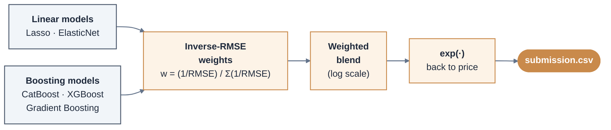

<div align="center">

# House Price Prediction

### End-to-end machine learning pipeline for the Kaggle Ames Housing competition

<br/>

<p align="center">


</p>

<p align="center">


</p>

<p align="center">


</p>

<p align="center">


</p>

[**Overview**](#overview) · [**Pipeline**](#pipeline) · [**Methodology**](#methodology) · [**Performance**](#model-performance) · [**Blending**](#model-blending) · [**Result**](#final-submission) · [**Run It**](#how-to-run)

</div>

---

## Table of Contents

- [Overview](#overview)
- [Project Structure](#project-structure)
- [Pipeline](#pipeline)
- [Methodology](#methodology)
- [Model Performance](#model-performance)
- [Model Blending](#model-blending)
- [Prediction Analysis](#prediction-analysis)
- [Final Submission](#final-submission)
- [How to Run](#how-to-run)
- [Key Insights](#key-insights)
- [What This Project Demonstrates](#what-this-project-demonstrates)
- [Future Improvements](#future-improvements)
- [License](#license)

---

## Overview

This project implements a complete machine learning pipeline for predicting residential housing prices using the **Ames Housing** dataset. The workflow covers data exploration, feature engineering, model development, evaluation, and final ensemble blending.

The objective is to minimise **Root Mean Squared Logarithmic Error (RMSLE)**, matching the Kaggle competition's evaluation metric.

<div align="center">

| Public leaderboard score | Best single-model CV RMSE | Evaluation |
|:---:|:---:|:---:|
| **0.12193** RMSLE | **0.12406** (Tuned CatBoost) | 5-fold cross-validation |

</div>

---

## Project Structure

```text
house-price-prediction/
│
├── notebooks/
│   ├── 01_eda.ipynb
│   ├── 02_feature_engineering.ipynb
│   └── 03_modeling.ipynb
│
├── outputs/
│   ├── submission.csv
│   │
│   ├── modeling_outputs/
│   │   ├── model_cv_results.csv
│   │   ├── individual_model_predictions.csv
│   │   └── blend_weights.csv
│   │
│   └── catboost_info/
│       ├── learn_error.tsv
│       └── time_left.tsv
│
├── reports/
│   ├── feature_engineering.md
│   ├── model_summary.md
│   └── leaderboard_results.md
│
├── images/
├── README.md
├── requirements.txt
├── .gitignore
└── LICENSE
```

---

## Pipeline


---

## Methodology

### 1. Data Preparation

- Missing values handled using domain-aware strategies
- Outliers analysed and treated where necessary
- Categorical variables encoded appropriately
- Numerical features transformed for stability

**Target transformation:**

$$y = \log(\text{SalePrice})$$

Predictions are converted back with:

$$\text{SalePrice} = \exp(\hat{y})$$

### 2. Feature Engineering

Key transformations include:

- Interaction features between important variables
- Polynomial expansions for non-linear relationships
- Aggregated neighbourhood-based statistics
- Log transformations for skewed distributions

The focus was on improving **signal quality** rather than increasing feature count.

### 3. Model Development

| Family | Models |
|---|---|
| **Linear** | Ridge · Lasso · ElasticNet · Bayesian Ridge |
| **Tree-based** | Random Forest · Gradient Boosting · XGBoost · LightGBM · CatBoost |

Linear models were scaled using `RobustScaler`. Tree-based models were used without scaling.

### 4. Evaluation Strategy

All models were evaluated with **5-fold cross-validation**, using:

$$\text{RMSE on } \log(\text{SalePrice})$$

This aligns directly with the Kaggle RMSLE objective.

---

## Model Performance

Cross-validation results are stored in `outputs/modeling_outputs/model_cv_results.csv`.

| Model | Baseline CV RMSE | Tuned CV RMSE | Change |
|---|:---:|:---:|:---:|
| **CatBoost** | 0.12407 | **0.12406** | -0.00001 |
| **Gradient Boosting** | 0.12729 | 0.12457 | -0.00272 |
| **Lasso** | 0.12595 | 0.12600 | +0.00005 |
| **ElasticNet** | 0.12604 | 0.12617 | +0.00013 |
| **XGBoost** | 0.12652 | 0.12656 | +0.00004 |

*Lower is better. Change is tuned minus baseline.*

**Observations**

- Boosting models capture complex non-linear relationships effectively
- Regularised linear models remain competitive thanks to strong feature engineering
- Tuning helped Gradient Boosting most; the other models were already close to their best
- Model diversity enables effective ensemble construction

---

## Model Blending

Final predictions use **inverse-RMSE weighted averaging**. Each model's weight is the inverse of its cross-validation RMSE, normalised so the weights sum to one:

$$w_i = \frac{1 / \text{RMSE}_i}{\sum_j 1 / \text{RMSE}_j}$$



Blend weights are stored in `outputs/modeling_outputs/blend_weights.csv`.

**Rationale**

- Stronger models contribute more to the final prediction
- Weaker models are automatically down-weighted
- Blending reduces variance and improves generalisation

---

## Prediction Analysis

Individual model predictions are available in `outputs/modeling_outputs/individual_model_predictions.csv`.

- Boosting models show tighter prediction distributions
- Linear models provide stability
- The ensemble reduces extreme prediction variance

---

## Final Submission

The submission file is `outputs/submission.csv`, in the standard Kaggle format:

| Id | SalePrice |
|:---:|:---:|
| *test house ID* | *predicted price* |

<div align="center">

### Public Leaderboard Score: **0.12193** RMSLE

</div>

This score reflects strong generalisation and effective ensemble modelling.

---

## How to Run

```bash
# Clone the repository
git clone https://github.com/Nomusa990822/house-price-prediction.git

# Move into the project
cd house-price-prediction

# Install dependencies
pip install -r requirements.txt
```

Then run the notebooks in order:

```text
01_eda  →  02_feature_engineering  →  03_modeling
```

---

## Key Insights

- Feature engineering is the primary driver of performance
- Ensemble learning outperforms individual models
- Model diversity is more valuable than model complexity
- Proper validation prevents overfitting

---

## What This Project Demonstrates

- End-to-end machine learning pipeline design
- Strong feature engineering techniques
- Robust validation strategy
- Model comparison and optimisation
- Ensemble learning and blending
- Reproducible data science workflow

---

## Future Improvements

- [ ] Advanced stacking (meta-model)
- [ ] Feature selection optimisation
- [ ] SHAP-based model explainability
- [ ] Hyperparameter optimisation using Optuna
- [ ] Deployment as a prediction API

---

## License

This project is licensed under the MIT License.

<div align="center">

<sub>[Back to top](#house-price-prediction)</sub>

</div>
